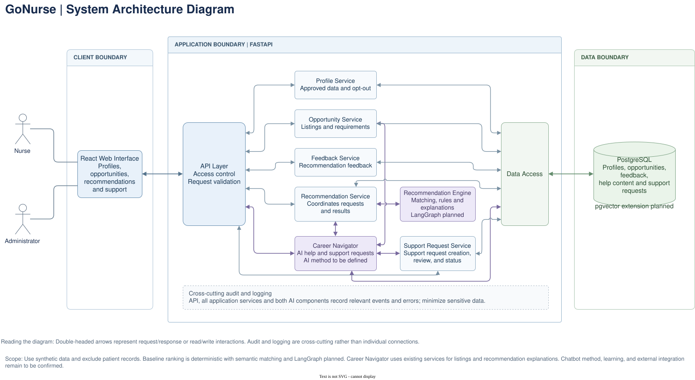

# GoNurse

GoNurse is a nurse-facing workforce development project that helps nurses
discover internal opportunities aligned with their skills, interests, and
availability. It is not a patient-care system and does not make employment
decisions.

## Project goals

- Let nurses manage their profiles and opt in to recommendations.
- Help nurses explore opportunities and understand why matches are suggested.
- Provide Career Navigator guidance and a nurse-initiated path to human support.
- Let administrators manage opportunities and respond to support requests.

## Design overview

The proposed architecture uses a React web interface, a FastAPI application,
and PostgreSQL storage. Application services manage profiles, opportunities,
recommendations, feedback, and support. The Recommendation Service supplies
approved profile and opportunity data to the Recommendation Engine, which
filters and ranks matches. Career Navigator uses existing services rather than
independently ranking opportunities.



[Editable architecture diagram](docs/architecture.drawio)

The design identifies auditing and logging as cross-cutting concerns. An
external database integration boundary and a 10,000-concurrent-user planning
target are part of the design, not verified capabilities of the prototype.
Embeddings, pgvector similarity search, and LangGraph are possible future
extensions rather than initial requirements.

## Current prototype

The [local prototype](Prototype/README.md) demonstrates profiles, opportunity
discovery, recommendation feedback, Career Navigator, and support requests
using synthetic data. It includes a React interface, FastAPI endpoints, and
PostgreSQL storage.
An alternative [tabbed prototype](Prototype/README.md) presents the same
sections individually while leaving the original grid view available.

**Important limitations:**

- Matching and Career Navigator use deterministic rules; a functional AI
  feature has not yet been implemented.
- Demo identities are client-selected and are not real authentication. The
  prototype is for local use only, not production or network exposure.
- Auditing is minimal; external database integration is not implemented.
- Do not use patient records, real employee information, or other sensitive
  data.

See the [prototype README](Prototype/README.md) for Windows setup instructions,
tests, matching rules, and known differences from the design.

## Repository layout

```text
docs/         Architecture diagram and editable source
Prototype/
  backend/    FastAPI application, database models, and tests
  frontend/   React interface
  README.md   Local setup and prototype details
```

The completed Unit 3 system design specification is intended to be added
separately as project documentation.
